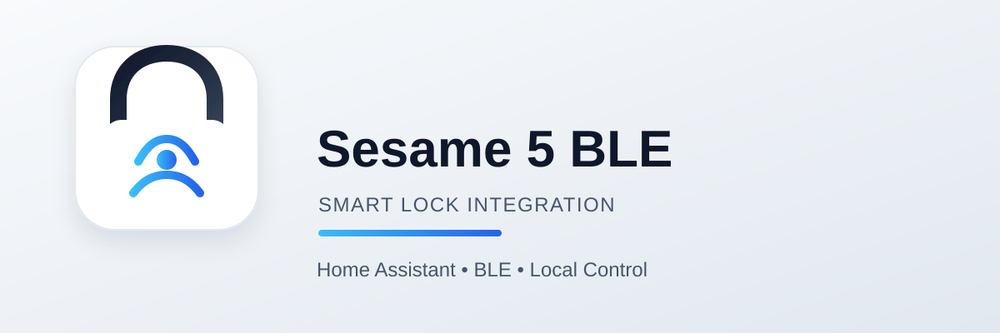

# ha-sesame5-ble

<p align="center">
  
</p>

<p align="center">
  <strong>CANDY HOUSE セサミ（SESAME）スマートロックおよびセサミタッチシリーズを Bluetooth Low Energy (BLE) で直接操作する Home Assistant カスタムインテグレーション</strong><br>
  <em>100% ローカル制御 • 超低遅延 • 専用ハブ・クラウド不要</em>
</p>

<p align="center">
  <a href="README.md"><strong>English</strong></a> •
  <a href="README_JA.md"><strong>日本語</strong></a>
</p>

<p align="center">
  <a href="https://github.com/hacs/default"></a>
  <a href="https://github.com/shenwii/ha-sesame5-ble/releases"></a>
  <a href="https://www.home-assistant.io"></a>
  <a href="LICENSE"></a>
</p>

---

## ✨ 主な特徴

- ⚡ **完全ローカル制御**: Bluetooth LE 経由でセサミデバイスと直接通信します。Wi-Fiアクセスポイントハブ（Sesame Hub）や CANDY HOUSE のクラウドサーバー、インターネット接続は一切不要です。
- 🚀 **プッシュ通知による状態更新**: 無駄な定期ポーリングを行わず、[`gomalock`](https://github.com/meronepy/gomalock) のステータスコールバックを活用して状態変化を即座に受信。デバイスのバッテリー消費を最小限に抑えます。
- 📱 **幅広いデバイスに対応**: Sesame 5、Sesame 5 Pro、Sesame 5 US、Sesame Touch / Touch Pro などに対応しています。
- 🔒 **充実したエンティティ構成**:
  - `lock` エンティティによる**施錠**、**解錠**、**ラッチ開放（Open）**操作。
  - スマートロック本体およびタッチデバイスのリアルタイムバッテリー残量（%）。
  - サムターンの現在角度（°）および施錠・解錠の閾値角度センサー。
  - セサミタッチの登録カード数・指紋数・暗証番号数のモニタリング。
  - 状態確認をスキップして確実に操作する「強制施錠」「強制解錠」ボタン。
- 🛠️ **専用 Home Assistant サービス**: 状況復帰用の強制施錠/解錠サービスや、施錠・解錠位置の動的設定サービスを提供。
- 🌍 **多言語対応**: 日本語、英語、簡体字中国語、繁体字中国語の UI 翻訳を内蔵。

---

## 📟 対応デバイス

| デバイス名 | 種別 | 対応機能 |
| :--- | :--- | :--- |
| **Sesame 5 (セサミ5)** | スマートロック | 施錠、解錠、ラッチ開放、バッテリー、角度、閾値設定 |
| **Sesame 5 Pro (セサミ5 Pro)** | スマートロック | 施錠、解錠、ラッチ開放、バッテリー、角度、閾値設定 |
| **Sesame 5 US** | スマートロック | 施錠、解錠、ラッチ開放、バッテリー、角度、閾値設定 |
| **Sesame Touch (セサミタッチ)** | カード/指紋リーダー | バッテリー、登録カード数、指紋数、暗証番号数 |
| **Sesame Touch Pro (セサミタッチ Pro)** | カード/指紋リーダー | バッテリー、登録カード数、指紋数、暗証番号数 |
| *その他の Sesame OS3 BLE デバイス* | 各種 | `gomalock` ライブラリの対応状況に準じます |

---

## 📋 動作要件

- **Home Assistant**: バージョン `2024.1.0` 以降
- **Bluetooth アダプター**: Home Assistant 稼働ホスト上で動作する Bluetooth（内蔵アダプターまたは USB Bluetooth ドングル）
- **Python**: バージョン `3.12` 以降
- **Python ライブラリ**: [`gomalock`](https://github.com/meronepy/gomalock)（Home Assistant により自動インストールされます）

> [!TIP]
> USB 3.0 ポート周辺のノイズ（2.4GHz 帯）は Bluetooth 通信に干渉することが知られています。感度や安定性を高めるため、Bluetooth ドングルは USB 2.0 ポートに接続するか、USB 延長ケーブルを使用して本体から少し離して設置することをおすすめします。

---

## 📦 インストール方法

### 方法 1: HACS を使用（推奨）

1. お使いの Home Assistant に [HACS](https://hacs.xyz/) がインストールされていることを確認します。
2. Home Assistant のサイドバーから **HACS** → **Integrations (統合)** を開きます。
3. 右上のメニュー（**⋮**）から **Custom repositories (カスタムリポジトリ)** を選択します。
4. 以下の情報を入力します：
   - **リポジトリ**: `https://github.com/shenwii/ha-sesame5-ble`
   - **カテゴリ**: `Integration`
5. **Add (追加)** をクリックします。
6. 統合一覧から **Sesame 5 BLE** を検索し、**Download (ダウンロード)** をクリックしてインストールします。
7. **Home Assistant を再起動**します。

### 方法 2: 手動インストール

1. 本リポジトリをクローンまたはダウンロードします：
   ```bash
   git clone https://github.com/shenwii/ha-sesame5-ble.git
   ```
2. `custom_components/sesame5_ble` フォルダを、Home Assistant 設定ディレクトリ内の `custom_components` 配下にコピーします：
   ```bash
   cp -r ha-sesame5-ble/custom_components/sesame5_ble /path/to/your/ha-config/custom_components/
   ```
3. Home Assistant を再起動します。

---

## ⚙️ 初期設定と登録方法

### 1. 統合の追加

1. Home Assistant の **設定** → **デバイスとサービス** → **統合を追加** を開きます。
2. **Sesame 5 BLE** を検索して選択します。
3. 周囲の Sesame デバイスが自動スキャンされ、MACアドレス、モデル名、登録状況が一覧表示されます。
4. 追加したいデバイスを選択します。

### 2. デバイス登録と Secret Key（シークレットキー）

デバイスが公式アプリですでに登録済みかどうかによって設定手順が異なります：

#### パターン A: すでに公式セサミアプリに登録済みの場合（推奨）
セサミ公式アプリで初期設定が完了している場合：
1. Home Assistant の設定画面で **`SECRET_KEY`** の入力を求められます。
2. **`SECRET_KEY` の取得方法**:
   - スマホの **セサミ公式アプリ** を開きます。
   - 該当のデバイスをタップし、右上の **歯車（設定）アイコン** をタップします。
   - **鍵を共有** を選択し、**QRコード（オーナーまたはマネージャー権限）** を表示します。
   - 任意の QR コードリーダーアプリでこの QR コードを読み取ります。読み取った URL は通常以下の形式です：
     ```text
     ssm://UI?sk=...&pk=...&l=...
     ```
   - パラメータ `sk=` の直後にある文字列が **`SECRET_KEY`**（16バイトの16進数文字列またはBase64文字列）です。
   - （または [`gomalock`](https://github.com/meronepy/gomalock) CLI ツールを使って取得することも可能です）
3. 取得した `SECRET_KEY` を Home Assistant に入力して送信します。

#### パターン B: 未登録の新規デバイスを登録する場合
デバイスがどのアプリにも登録されていない場合：
1. 画面上でデバイスの新規登録を行うか確認されます。
2. 承認すると、Home Assistant 経由で登録処理が行われ、生成されたキーが保存されます。

> [!WARNING]
> 基本的には **まず公式セサミアプリでデバイスを登録し、生成された `SECRET_KEY` を Home Assistant に入力する方法を強く推奨します**。Home Assistant で直接新規登録を行うと、セサミ公式アプリから簡単に合鍵共有できなくなる場合があります。

---

## 🧩 エンティティ一覧

### セサミ スマートロック デバイス

| エンティティ名 | プラットフォーム | 単位 / 種別 | 説明 |
| :--- | :--- | :--- | :--- |
| **Sesame Lock** | `lock` | Lock | ロックの基本操作（**施錠**、**解錠**、**ラッチ開放 (Open)**）。 |
| **Lock State** | `binary_sensor` | `BinarySensorDeviceClass.LOCK` | UI・自動化用の施錠状態（`on` = 解錠中、`off` = 施錠中）。 |
| **Battery** | `sensor` | パーセント (`%`) | スマートロック本体のバッテリー残量。 |
| **Position** | `sensor` | 度 (`°`) | サムターンの現在の物理的な回転角度。 |
| **Lock Position** | `sensor` | 度 (`°`) | 設定されている施錠位置の閾値角度。 |
| **Unlock Position** | `sensor` | 度 (`°`) | 設定されている解錠位置の閾値角度。 |
| **Force Lock** | `button` | Button | 現在の状態判定をスキップして強制的に施錠コマンドを発行。 |
| **Force Unlock** | `button` | Button | 現在の状態判定をスキップして強制的に解錠コマンドを発行。 |

### セサミタッチ / セサミタッチ Pro デバイス

| エンティティ名 | プラットフォーム | 単位 / 種別 | 説明 |
| :--- | :--- | :--- | :--- |
| **Battery** | `sensor` | パーセント (`%`) | セサミタッチのバッテリー残量。 |
| **Cards Number** | `sensor` | 個数 | 登録されている IC カード / RFID の件数。 |
| **Fingerprints Number**| `sensor` | 個数 | 登録されている指紋の件数。 |
| **Passwords Number** | `sensor` | 個数 | 設定されている暗証番号（パスコード）の件数。 |

---

## 🔧 カスタムサービス

`sesame5_ble` ドメイン配下に以下のカスタムサービスが用意されています：

### `sesame5_ble.lock`
現在の状態に関係なく、強制的に施錠コマンドを発行します。
```yaml
service: sesame5_ble.lock
data:
  entry_id: "対象の設定エントリID" # 省略時は登録済みの全セサミロックが対象
```

### `sesame5_ble.unlock`
現在の状態に関係なく、強制的に解錠コマンドを発行します。
```yaml
service: sesame5_ble.unlock
data:
  entry_id: "対象の設定エントリID" # 省略時は登録済みの全セサミロックが対象
```

### `sesame5_ble.set_lock_position`
物理的な施錠・解錠の閾値角度を動的に変更します。
```yaml
service: sesame5_ble.set_lock_position
data:
  entry_id: "対象の設定エントリID" # 省略可
  lock_position: 180              # 必須: 施錠位置角度
  unlock_position: 90             # 必須: 解錠位置角度
```

---

## 💡 自動化（オートメーション）の設定例

### 1. 就寝時の自動戸締まり
```yaml
alias: "深夜23時の玄関自動施錠"
trigger:
  - platform: time
    at: "23:00:00"
condition:
  - platform: state
    entity_id: lock.sesame_lock
    state: "unlocked"
action:
  - service: lock.lock
    target:
      entity_id: lock.sesame_lock
```

### 2. 電池残量低下時のスマートフォン通知
```yaml
alias: "セサミ電池残量低下通知"
trigger:
  - platform: numeric_state
    entity_id: sensor.sesame_device_battery
    below: 20
action:
  - service: notify.notify
    data:
      title: "スマートロックのバッテリー低下"
      message: >
        玄関のセサミの電池残量が残り {{ states('sensor.sesame_device_battery') }}% です。早めにCR123A電池を交換してください。
```

---

## 🏛️ アーキテクチャと内部設計

```
┌────────────────────────────────────────────────────────┐
│                   Home Assistant Core                  │
│    (Lock プラットフォーム / 各種センサー / ボタンなど)   │
└─────────────┬────────────────────────────▲─────────────┘
   コマンド発行 │                            │  状態更新
   (非同期実行) │                            │  (BLE コールバック)
              ▼                            │
┌───────────────────────────┐    ┌───────────────────────┐
│     SesameCoordinator     │    │   SesameMechStatus    │
│  (接続管理・排他ロック制御)  │    │  コールバックリスナー  │
│                           │    │  (ゼロポーリング方式) │
└─────────────┬─────────────┘    └─────────▲─────────────┘
              │                            │
              ▼                            │
┌────────────────────────────────────────────────────────┐
│               gomalock (Python BLE ドライバ)           │
│        (OS3 プロトコル / Bleak / BLE アドバタイズ)      │
└───────────────────────────┬────────────────────────────┘
                            │ BLE GATT / アドバタイズ
                            ▼
         [CANDY HOUSE セサミ 5 / セサミタッチ デバイス]
```

- **操作系（コマンド）と状態系の分離**:
  - **コマンド実行**: `lock` / `unlock` / `open` 操作はデバイスごとの非同期ロック（`asyncio.Lock`）を介して排他制御され、Bluetooth 通信の衝突を防ぎます。
  - **状態監視**: 高頻度なポーリングを一切行わず、`gomalock` の push 通知コールバックを待受けて Home Assistant の状態を即座に更新します。
- **リソース管理**: インテグレーションの無効化や Home Assistant の再起動時には、デバイスとの BLE 接続リソースを安全にクリーンアップします。

---

## ❓ よくある質問 (FAQ)

<details>
<summary><strong>Q: スキャン時に「近くに Sesame BLE デバイスが見つかりませんでした」と表示されます</strong></summary>

1. Home Assistant が稼働しているマシンで Bluetooth が正常に動作しているか確認してください。
2. セサミロックが電波の届く範囲内（遮蔽物のない直線で 5〜10m 程度）にあるか確認してください。
3. スマートフォンのセサミ公式アプリが現在進行系で接続・通信している場合、他の端末からの接続が拒否されることがあります。スマートフォンのアプリを一度タスクキルしてから再度スキャンをお試しください。
4. USB 3.0 ポートのノイズによる受信障害を防ぐため、USB 延長ケーブルを使用して Bluetooth ドングルを設置してください。
</details>

<details>
<summary><strong>Q: ESPHome の Bluetooth Proxy は利用できますか？</strong></summary>

現時点では、Sesame OS3 デバイスとのアクティブな GATT 通信および暗号化ハンドシェイクをホスト側の `Bleak` スタックで直接制御しています。そのため、Home Assistant ホスト本体に接続された Bluetooth アダプターまたは USB ドングルの利用を推奨します。
</details>

<details>
<summary><strong>Q: カスタムサービスで使用する「設定エントリID (entry_id)」はどこで確認できますか？</strong></summary>

**設定** → **デバイスとサービス** → **Sesame 5 BLE** → 対象のデバイスページを開きます。ブラウザの URL バーに表示される `config_entries/` に続く英数字が entry_id です。（1台のみ利用している場合は `entry_id` を省略しても構いません）。
</details>

---

## 🧑‍💻 開発者向け: gomalock を使用した単体テスト例

Home Assistant を介さずに Python スクリプト単体でデバイスの接続テストを行う例です：

```python
import asyncio
import gomalock

ADDRESS = "XX:XX:XX:XX:XX:XX"  # デバイスの MAC アドレス
SECRET_KEY = "your_hex_secret_key"  # 16進数のシークレットキー

async def main():
    async with gomalock.Sesame5(ADDRESS, secret_key=SECRET_KEY) as lock:
        await lock.connect()
        await lock.login()
        print("バッテリー残量:", lock.mech_status.battery_percentage)
        print("施錠状態:", lock.mech_status.is_in_lock_range)
        # 解錠する場合: await lock.unlock("script")
        # 施錠する場合: await lock.lock("script")

asyncio.run(main())
```

---

## 📄 ライセンス

本プロジェクトは [MIT License](LICENSE) のもとで公開されています。

## 🙏 謝辞

- セサミシリーズを開発・提供されている [CANDY HOUSE 様](https://jp.candyhouse.co/)
- 素晴らしい BLE ライブラリ [`gomalock`](https://github.com/meronepy/gomalock) を作成された [@meronepy 様](https://github.com/meronepy)
